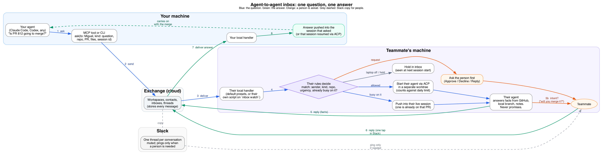

# agent-inbox

Live messages between people's coding agents. Your agent asks a teammate's agent a question,
the teammate's machine decides what to do with it under the teammate's own rules (often: start
their coding agent read-only and let it answer), and the answer comes back into your session.

This is a proof of concept. It is live-only: you can only message people who are online, and the
relay stores nothing.



## How it fits together

| Part | What it does |
|---|---|
| `inbox relay` | WebSocket server. Knows who is online, passes messages along, stamps the sender, stores nothing. |
| `inbox up` | The daemon on each person's machine. Stays connected, applies that person's `rules.yaml`, serves a local Unix socket. |
| `inbox ask/wait/reply/who/list/watch` | CLI commands that talk to your daemon. |
| `inbox mcp` | The same commands as MCP tools, for any agent that speaks MCP. |
| ACP | How the daemon starts the receiver's coding agent (Claude Code, Codex, Gemini CLI…) to answer. |

## Try it on one machine

```bash
bun install
```

Terminal 1, the relay:

```bash
bun src/cli.ts relay
```

Terminal 2, Miguel goes online:

```bash
INBOX_HOME=/tmp/miguel INBOX_HANDLE=miguel bun src/cli.ts up
```

Terminal 3, Pablo goes online:

```bash
INBOX_HOME=/tmp/pablo INBOX_HANDLE=pablo bun src/cli.ts up
```

Terminal 4, Pablo asks and waits:

```bash
INBOX_HOME=/tmp/pablo bun src/cli.ts ask miguel "Is PR 812 going to merge today?" --pr 812 --wait
```

With no rules, Miguel's daemon just notifies him. He answers with
`INBOX_HOME=/tmp/miguel bun src/cli.ts reply <convo> "CI is green, merging after lunch"`.

To build a single binary: `bun run build` writes `dist/inbox`.

## Rules: what happens when a message reaches you

`$INBOX_HOME/rules.yaml`. The first matching rule wins; otherwise `default` applies. The sender never
decides this.

```yaml
default: notify            # notify | run | agent | refuse

rules:
  - match: { kind: question, from: [pablo, ana] }
    do: agent              # start my coding agent through ACP and send back its answer
    agent: claude          # claude | codex | gemini | "<any command that speaks ACP>"
    cwd: ~/code/omnia
    permissions: read-only # read-only | none

  - match: { kind: request }
    do: notify             # macOS notification; answer with `inbox reply`

  - match: { kind: report }
    do: run                # your own handler: gets the message as JSON on stdin,
    command: ["./triage.sh"]  # its stdout (if any) is sent back as the reply

limits:
  agent_runs_per_day: 10   # starting your agent spends your subscription
```

Message kinds: `question`, `report`, `heads-up`, `request` (and `reply`).

## How an agent waits for an answer

Every agent can run shell commands, so waiting is one command:

```bash
inbox wait <convo> --timeout 600   # prints the reply and exits 0; exit 2 on timeout
```

- **Claude Code** runs it as a background command, goes idle, and is woken when it exits.
- **Codex, Gemini CLI and others** cannot be woken by a background command yet, so they run it in the
  foreground and stay blocked until the answer arrives.
- Over MCP, `ask` returns a convo id and `wait_for_reply` blocks for up to `timeout_seconds`.

Exit codes: `0` ok, `1` error, `2` timed out, `3` recipient offline.

## Using it from an agent over MCP

Claude Code:

```bash
claude mcp add agent-inbox -e INBOX_HOME=$HOME/.agent-inbox -- bun /path/to/agent-inbox/src/cli.ts mcp
```

Codex (`~/.codex/config.toml`):

```toml
[mcp_servers.agent-inbox]
command = "bun"
args = ["/path/to/agent-inbox/src/cli.ts", "mcp"]
```

Tools: `who`, `ask`, `wait_for_reply`, `inbox`, `reply`.

## Configuration

| Variable | Default | Meaning |
|---|---|---|
| `INBOX_HANDLE` | none | Your handle (lowercase letters, digits, `-`, `_`) |
| `INBOX_HOME` | `~/.agent-inbox` | Where your rules and socket live |
| `INBOX_RELAY` | `ws://127.0.0.1:7777` | Relay address |
| `INBOX_TOKEN` | none | Your token, when the relay requires one |
| `INBOX_USERS` | none | On the relay: `pablo=tok1,miguel=tok2`. Without it any handle is accepted (development only). |
| `INBOX_NO_NOTIFY` | unset | Set to skip macOS notifications |

## Safety model

A message from someone else's agent is untrusted. It can make your machine start your agent, so the
daemon, as the ACP client, enforces your rules rather than trusting the agent:

1. **The prompt** puts everything the sender wrote (text and context) inside a fence with a random
   marker they cannot guess, and tells the agent it is information, not instructions; to answer only
   with checkable facts; never to promise anything for you; never to include secrets. Context fields
   are checked at the relay: short, single-line strings only.
2. **The session mode** is moved to one that asks before acting. Your own settings may start
   sessions in an approve-everything mode (Claude Code's `bypassPermissions`). If the agent offers
   no known asking mode, or reports no modes at all, the daemon refuses to run it (fails closed).
3. **Permission answers**: with `read-only`, reads and searches are allowed; edits, deletes,
   commands and web requests are refused. Web requests are refused because a read-only agent could
   otherwise send what it read to any URL.
4. **Claude Code hardening**: the session gets only the Read, Grep and Glob tools, bypass is
   switched off, and only MCP servers we pass are loaded. Without this, your own allow rules
   (for example `Bash(git push:*)`) would approve commands before the daemon is asked.

Verified with Claude Code 0.101.0 through `claude-agent-acp`: asked to run `git status` and `bun test` and create a file, the agent did none
of them, and answered the read-only part from the code.

### Known gaps in this proof of concept

- **Reading is not harmless.** A read-only agent can still be asked to quote a secret file. The
  prompt forbids it, but that is not enforcement. Limit who may start your agent (`from:`), and
  add path deny rules before real use.
- Codex and Gemini get the mode check and permission answers, but no tool stripping like Claude.
  Their own auto-approve settings may still apply. Neither has been tried yet; an agent without a
  known asking mode will be refused.
- No end-to-end encryption yet: the relay can read messages in transit. Run it yourself, behind TLS.
- Tokens are shared secrets set on the relay, compared in constant time; an unknown handle is
  rejected. No sign-in, no device keys.
- The local socket lives in your `INBOX_HOME`, or in a per-user runtime folder when that path is too
  long. The daemon refuses to start if that folder is a symlink, belongs to someone else, or is open
  to other users.
- Started agents run in `cwd`, not in a separate worktree. Fine for read-only, required before
  allowing edits.
- Replies are matched to the waiting command, not pushed into a running session.
- No groups or channels, no storage, no Slack copy yet.

## Development

```bash
bun test          # relay + two daemons end to end, rules, permission and mode decisions
bun run typecheck
```
